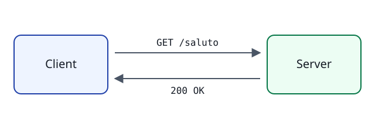

{/* Questa lezione mostra testo, riquadri, immagini e collegamenti. */}

Questo corso è diviso in **moduli**, ogni modulo in **lezioni**. Le lezioni contengono
testo, codice, video, quiz ed esercizi da svolgere sul tuo computer.

## Come studiare

1. Leggi la lezione e guarda i video.
2. Rispondi ai quiz: la correzione avviene sulla piattaforma.
3. Svolgi gli esercizi in locale con la CLI `learn`.

Puoi tornare indietro con <kbd>Alt</kbd> + <kbd>←</kbd>, e la prossima lezione spiega
[il ciclo richiesta-risposta](./02-protocollo-http.mdx#richiesta-e-risposta).

## I riquadri

<Callout>
  Un riquadro **nota** aggiunge informazioni utili ma non indispensabili.
</Callout>

<Callout type="tip" title="Suggerimento">
  Tieni aperto un terminale mentre studi: ti servirà per gli esercizi.
</Callout>

<Callout type="warning">
  Gli esercizi richiedono Docker installato e avviato.
</Callout>

<Callout type="danger" title="Attenzione ai segreti">
  Non pubblicare mai password o chiavi nei repository.
</Callout>

Un riquadro **prova tu** propone un'attività guidata che nessuno controlla:

<Callout type="try">
  1. Apri un terminale ed esegui `curl -i https://example.com`.
  2. Guarda la prima riga della risposta: è lo stato HTTP, che vedrai nella prossima lezione.
</Callout>

## Il web in un'immagine

Le immagini si possono inserire anche con il componente `Image`, che accetta una didascalia:

<Image
  src="../../assets/richiesta-http.svg"
  alt="Schema di una richiesta GET /saluto e della risposta 200 OK"
  caption="Lo stesso schema, inserito con il componente Image."
/>

## Riepilogo

| Elemento | Dove si trova         |
| -------- | --------------------- |
| Modulo   | `modules/NN-nome/`    |
| Lezione  | `NN-nome.mdx`         |
| Attività | dentro una lezione[^1] |

  
Perché le attività hanno un id?

  L'id resta lo stesso tra le versioni del corso, così i progressi degli studenti non si perdono.

[^1]: Video, quiz ed esercizi sono attività tracciate.
