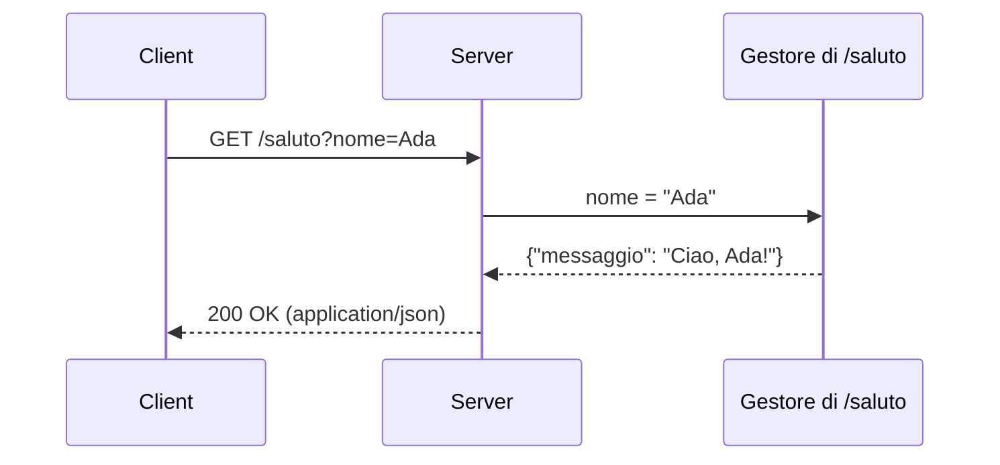

HTTP è il protocollo con cui browser e server si scambiano pagine e dati.

<Video
  id="video-http-crash-course"
  url="https://www.youtube.com/watch?v=iYM2zFP3Zn0"
  title="HTTP Crash Course & Exploration (Traversy Media, in inglese)"
/>

## Richiesta e risposta

Il client invia una **richiesta** con un metodo, un percorso e delle intestazioni:

```http title="Richiesta"
GET /saluto?nome=Ada HTTP/1.1
Host: localhost:8080
Accept: application/json
```

Il server risponde con un **codice di stato**, delle intestazioni e un corpo:

```http title="Risposta" {1}
HTTP/1.1 200 OK
Content-Type: application/json

{"messaggio": "Ciao, Ada!"}
```

Puoi scaricare [la richiesta d'esempio](../../assets/saluto.http) e provarla con il tuo client HTTP.

Lo stesso scambio, come diagramma di sequenza:

<Diagram
  alt="Il client invia GET /saluto?nome=Ada, il server lo inoltra al gestore della rotta e risponde 200 OK con il messaggio in JSON"
  caption="Una richiesta e la sua risposta"
>

</Diagram>

Il corpo della risposta è un testo in JSON. Prova a cambiare il nome o ad aggiungere un campo, poi
premi «Esegui»:

<Playground title="Costruisci il corpo della risposta">
```js
const nome = 'Ada';
const corpo = { messaggio: `Ciao, ${nome}!` };
console.log(JSON.stringify(corpo));
console.log(JSON.parse('{"stato": 200}').stato);
```
</Playground>

In TypeScript i tipi vengono controllati prima di eseguire il codice. Cambia `200` con `'200'`:
il codice non parte, e il riquadro mostra l'errore di tipo con la sua riga.

<Playground title="Il corpo della risposta, con i tipi">
```ts
type Risposta = { stato: number; messaggio: string };

const risposta: Risposta = { stato: 200, messaggio: 'Ciao, Ada!' };
console.log(`${risposta.stato} ${risposta.messaggio}`);
```
</Playground>

Lo stesso in Kotlin: il codice non si esegue nel browser, ma puoi modificarlo e copiarlo per
provarlo nel tuo progetto.

<Playground title="Il messaggio in Kotlin">
```kotlin
data class Saluto(val messaggio: String)

fun main() {
    val nome = "Ada"
    println(Saluto("Ciao, $nome!"))
}
```
</Playground>

## Il viaggio di una richiesta

Prima di arrivare al codice del server, una richiesta passa dal DNS e apre una connessione TCP e TLS.
Seguila fase per fase con «Avanti»: il simulatore è completato quando arrivi all'ultima fase, quella
in cui il browser mostra la risposta.

<Simulator id="ciclo-di-vita-richiesta" title="Il ciclo di vita di una richiesta HTTP" height={480} />

## Dalla richiesta alla rotta

Il server sceglie chi risponde confrontando metodo e percorso con le sue **rotte**. Prova qualche
richiesta: `GET /saluto/Ada`, `DELETE /saluto` o `GET /ciao`. Il simulatore è completato quando hai
ottenuto tutti e tre gli esiti: una rotta che risponde, `404 Not Found` e `405 Method Not Allowed`.

<Simulator id="router-http" title="Router HTTP" height={560} />

## Un servizio in due linguaggi

Lo stesso endpoint scritto in Kotlin con Spring Boot e in Rust con Axum:

<CodeTabs>

```kotlin title="SalutoController.kt" showLineNumbers {6-7}
@RestController
class SalutoController {
    @GetMapping("/saluto")
    fun saluto(
        @RequestParam nome: String?,
    ): Map<String, String> =
        mapOf("messaggio" to "Ciao, ${nome ?: "mondo"}!")
}
```

```rust title="main.rs" showLineNumbers
async fn saluto(Query(params): Query<HashMap<String, String>>) -> Json<Value> {
    let nome = params.get("nome").map_or("mondo", String::as_str);
    Json(json!({ "messaggio": format!("Ciao, {nome}!") }))
}
```

</CodeTabs>

## Una modifica al codice

I blocchi possono mostrare le righe aggiunte e rimosse:

```kotlin title="SalutoController.kt" ins={3} del={2}
@GetMapping("/saluto")
fun saluto(): String = "Ciao!"
fun saluto(): Map<String, String> = mapOf("messaggio" to "Ciao!")
```

## Verifica

<Quiz id="quiz-http-basi" title="Verifica le basi di HTTP" attempts={3}>
  <Question id="metodo-idempotente" type="single" explanation="Un metodo è idempotente se ripeterlo produce lo stesso effetto di eseguirlo una volta.">
    Quale di questi metodi HTTP è **idempotente**?

    <Option correct explanation="`PUT` sostituisce la risorsa: ripeterlo non cambia il risultato.">`PUT`</Option>
    <Option explanation="Ogni `POST` può creare una nuova risorsa.">`POST`</Option>
    <Option explanation="`PATCH` può applicare modifiche che dipendono dallo stato attuale.">`PATCH`</Option>
  </Question>

  <Question id="codici-successo" type="multiple" objectives={["test-http"]}>
    Quali codici di stato indicano un **successo**?

    <Option id="ok" correct>`200 OK`</Option>
    <Option id="created" correct>`201 Created`</Option>
    <Option id="not-found" explanation="`404` indica che la risorsa non esiste.">`404 Not Found`</Option>
  </Question>

  <Question id="get-con-corpo" type="true-false" answer={false} objectives={["endpoint-get"]} explanation="Una richiesta `GET` di norma non ha corpo: i parametri vanno nel percorso o nella query.">
    Una richiesta `GET` deve sempre avere un corpo.
  </Question>
</Quiz>
