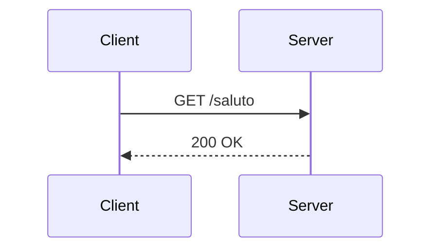

# Formato dei corsi

Guida per gli autori e specifica del formato dei sorgenti dei corsi Learn2K, **versione 1 dello schema dei contenuti**. Il corso [`courses/demo`](../../courses/demo) usa ogni elemento descritto qui ed è il riferimento da copiare.

Requisiti coperti: AUT-01, AUT-02 (parte), AUT-04, AUT-05, AUT-06, AUT-07, AUT-08, PUB-01, MED-04. Le decisioni di fondo sono nell'ADR 003 e nell'ADR 006.

## In breve

1. Crea il corso: `learn-author new course mio-corso --title "Il mio corso"`.
2. Avvia l'anteprima: `learn-author preview mio-corso` e apri http://localhost:5175. Ogni salvataggio aggiorna la pagina in meno di un secondo.
3. Scrivi le lezioni in MDX: Markdown più i componenti didattici (`<Quiz>`, `<Video>`, …).
4. Controlla i sorgenti: `learn-author validate mio-corso`. Gli errori indicano file, riga e colonna.
5. Compila: `learn-author build mio-corso` produce il bundle e il manifest in `mio-corso/dist/`.
6. Pubblica: `learn-author publish mio-corso` carica il corso sulla piattaforma come nuova versione (vedi [Pubblicazione](#pubblicazione)).

`learn-author` si installa scaricando il file del proprio sistema, come spiega il [README del programma](https://github.com/gmalnati/learn-author#installazione). Nel repository della piattaforma si esegue anche con `node packages/content-compiler/bin/learn-author.js`, oppure con `make demo-course` e `make preview` per il corso demo. I messaggi sono in italiano; per l'inglese usa `--lang en` o `LEARNLAB_LANG=en`.

## Struttura delle cartelle

```
mio-corso/
├── course.yaml                    metadati del corso
├── modules/
│   ├── 01-introduzione/
│   │   ├── module.yaml            metadati del modulo
│   │   ├── 01-benvenuto.mdx       lezioni, in ordine di numero
│   │   └── 02-protocollo-http.mdx
│   └── 02-primo-servizio/
│       ├── module.yaml
│       ├── 01-ambiente-locale.mdx
│       └── 02-endpoint-di-saluto.mdx
├── assets/                        immagini e file scaricabili (consigliato)
├── exercises/
│   └── hello-http/                un esercizio: formato in esercizi.md
│       ├── README.md              consegna dell'esercizio
│       ├── verify/*.hurl          verifiche HTTP (con checks: http), comuni a tutti i linguaggi
│       ├── kotlin/                Dockerfile, compose.yaml, starter/, solution/
│       └── rust/
├── simulators/
│   └── router-http/
│       └── index.html             un simulatore: una sola pagina HTML (vedi <Simulator>)
└── banks/
    └── codici-di-stato.mdx        una banca di domande, da cui i quiz estraggono (vedi <Draw>)
```

- Cartelle dei moduli e file delle lezioni hanno la forma `NN-nome`: il **numero stabilisce l'ordine**, il nome serve solo a chi legge. Rinominare un file non cambia l'id della lezione.
- Ogni modulo ha un `module.yaml` e almeno una lezione `.mdx`.
- Gli asset possono stare ovunque nel corso. Si referenziano con percorsi **relativi** al file che li usa. I file fuori dalla cartella del corso sono rifiutati.
- `dist/` contiene l'output della build: va escluso dal repository (`learn-author new course` crea il `.gitignore`).

## Gli id

Corso, moduli, lezioni e attività (video, quiz, esercizi, simulatori) hanno un **id stabile**: è l'oggetto a cui sono legati i progressi e le statistiche degli studenti.

- Formato kebab-case: lettere minuscole, cifre e trattini, al massimo 64 caratteri (`protocollo-http`).
- Univoci in tutto il corso: moduli, lezioni e attività condividono lo stesso spazio di nomi.
- Scritti nei sorgenti, mai calcolati: `learn-author new` li ricava dal titolo una sola volta, poi restano nel file. **Non cambiarli** dopo la pubblicazione, anche se cambi il titolo.
- Le domande di un quiz hanno id univoci nel quiz. Le opzioni hanno id univoci nella domanda; se non lo indichi, l'id è la lettera della posizione (`a`, `b`, `c`…). Se pensi di riordinare le opzioni, dai loro un id esplicito.

## `course.yaml`

```yaml
schemaVersion: 1          # versione del formato, obbligatoria
id: demo
title: Corso demo di Learn2K
description: Un breve corso sul protocollo HTTP.
language: it              # it | en: lingua dei contenuti
level: beginner           # facoltativo: beginner | intermediate | advanced
tags: [http, web]         # facoltativo
authors:
  - name: Team Learn2K
    email: team@example.test   # facoltativo
profiles: { kotlin: web, rust: web }   # facoltativo: toolchain degli esercizi, base se manca
exercisesFrom: ../web-lato-server     # facoltativo: gli esercizi di un altro corso (traduzioni)
```

`profiles` sceglie per ogni linguaggio degli esercizi la toolchain: `base`, leggera, o `web`, con le librerie dei servizi web (vedi «Il progetto» nella [guida agli esercizi](esercizi.md)). Il README di un esercizio può cambiarla con lo stesso campo.

`exercisesFrom` serve a un corso tradotto (ADR 029): gli esercizi sono quelli del corso indicato, una cartella accanto a questa, e qui ci sono solo i loro testi tradotti. Vedi «Esercizi presi da un altro corso» nella [guida agli esercizi](esercizi.md). Con `exercisesFrom` le toolchain sono quelle del corso d'origine, quindi `profiles` non si dichiara.

## `module.yaml`

```yaml
id: introduzione
title: Introduzione
description: Come funziona il corso.   # facoltativo
objectives:                            # facoltativo
  - Descrivere il ciclo richiesta-risposta di HTTP
```

## Le lezioni

Una lezione è un file MDX che inizia con un frontmatter YAML (AUT-07):

```mdx
---
id: protocollo-http
title: Il protocollo HTTP
duration: 20                      # minuti di lettura, prove e verifica, senza l'esercizio
objectives:                       # almeno uno
  - Descrivere il ciclo richiesta-risposta
prerequisites: [benvenuto]        # facoltativo: id di lezioni precedenti
tags: [http]                      # facoltativo
level: beginner                   # facoltativo
---

Testo della lezione in **Markdown**.

## Primo paragrafo
```

- Il titolo della lezione è mostrato dalla piattaforma: nel testo usa i titoli da `##` in giù.
- Markdown supportato: paragrafi, enfasi, elenchi, citazioni, tabelle, elenchi di attività, note a piè di pagina (`[^1]`), barrato, link automatici.
- Il testo resta entro 72 caratteri per riga; le tabelle possono occupare tutta la colonna della pagina e scorrono in orizzontale solo oltre. Una tabella dentro un altro componente (un `<Callout>`, un'opzione di un quiz) resta larga quanto il componente.
- Elementi HTML ammessi: `<kbd>`, `<abbr title="…">`, `<sub>`, `<sup>`, `<mark>`, `<small>`, `<s>`, `<ins>`, `<del>`, `<br />`, `<details open>` e `<summary>`.
- Commenti: `{/* testo */}`.
- **Non ammessi:** espressioni JavaScript (`{1 + 1}`), `import` ed `export`, componenti non elencati qui, attributi `{...spread}`. Le lezioni sono dati, non codice: il portale non esegue mai JavaScript scritto dagli autori.

### Collegamenti

| Scrivi | Diventa |
|---|---|
| `[testo](./02-altra-lezione.mdx)` | collegamento alla lezione (verificato) |
| `[testo](../02-modulo/01-lezione.mdx#titolo)` | collegamento a un titolo di un'altra lezione (verificato) |
| `[testo](#titolo)` | collegamento a un titolo della stessa lezione (verificato) |
| `[scarica](../../assets/esempio.http)` | file incluso nel bundle |
| `[MDN](https://developer.mozilla.org)` | collegamento esterno (`http`, `https`, `mailto`) |

L'ancora di un titolo è il testo in minuscolo con i trattini: `## Richiesta e risposta` → `#richiesta-e-risposta`.

## Componenti didattici

I componenti si scrivono su righe proprie, separati dal testo da una riga vuota. I valori degli attributi sono stringhe (`title="…"`) o valori statici tra graffe (`attempts={3}`, `answer={false}`).

### Blocchi di codice (AUT-08)

Si scrivono con i normali blocchi Markdown. Dopo il linguaggio si possono aggiungere opzioni:

````mdx
```kotlin title="SalutoController.kt" showLineNumbers {6-7}
@RestController
class SalutoController { … }
```
````

| Opzione | Effetto |
|---|---|
| `title="Main.kt"` | nome del file mostrato sopra il codice |
| `showLineNumbers` | numeri di riga (non vengono copiati) |
| `{1,3-5}` oppure `mark={…}` | righe evidenziate |
| `ins={3}` / `del={2}` | righe aggiunte e rimosse, per mostrare una modifica; il pulsante **Copia** copia il codice senza le righe rimosse |

Il linguaggio è un id di [Shiki](https://shiki.style/languages) (`kotlin`, `rust`, `http`, `bash`, `json`, …) oppure `text`. L'evidenziazione avviene in fase di build.

### `<CodeTabs>`

Più versioni dello stesso codice, una per scheda. L'etichetta della scheda è il `title` del blocco o, in sua assenza, il linguaggio.

````mdx
<CodeTabs>

```kotlin title="SalutoController.kt"
…
```

```rust title="main.rs"
…
```

</CodeTabs>
````

### `<Callout>`

```mdx
<Callout type="tip" title="Suggerimento">
  Tieni aperto un terminale mentre studi.
</Callout>
```

| Attributo | Valori |
|---|---|
| `type` | `note` (predefinito), `tip`, `warning`, `danger` |
| `title` | facoltativo; in sua assenza il nome del tipo (es. «Attenzione») |

`type="try"` è il riquadro **Prova tu**: un'attività guidata (provare un comando, cambiare un esempio) che la piattaforma non controlla. Ha l'aspetto delle altre attività, con il titolo predefinito «Prova tu», ma non è un'attività tracciata: niente `id` né eventi. Usalo al posto di una sezione `## Prova tu`.

```mdx
<Callout type="try">
  1. Cambia `"Ada"` con il tuo nome ed esegui di nuovo.
  2. Prova a riassegnare una `val`: che errore ricevi?
</Callout>
```

### Immagini

```mdx


<Image src="../../assets/diagramma.svg" alt="Testo alternativo" caption="Didascalia" />
```

- Formati: avif, gif, jpg, png, svg, webp. Oltre 5 MB viene segnalato un avviso.
- Il testo alternativo è obbligatorio per l'accessibilità. Usa `alt=""` solo per immagini decorative.
- Un'immagine sta su una riga a sé, non in mezzo al testo.

### `<Diagram>` (AUT-03)

Un diagramma [Mermaid](https://mermaid.js.org/) scritto come testo nella lezione: sequenze, flussi, stati, classi, entità e relazioni.

`````mdx
<Diagram alt="Il client invia GET /saluto e il server risponde 200 OK" caption="Una richiesta">

</Diagram>
`````

| Attributo | Descrizione |
|---|---|
| `alt` | che cosa mostra il diagramma, per chi non lo vede (obbligatorio) |
| `caption` | didascalia sotto il diagramma (facoltativa) |

`<Diagram>` contiene solo un blocco ```` ```mermaid ````. Il compiler ne controlla la sintassi con il parser di Mermaid e segnala gli errori alla riga giusta del file (`diagram/syntax`). Il portale e l'anteprima lo disegnano con il tema della pagina, chiaro o scuro; sotto il diagramma lo studente può sempre aprirne il testo, che compare da solo se il disegno non riesce. Per sicurezza le etichette sono solo testo: niente HTML, link o gestori di clic (`click`) nei diagrammi. Un blocco ```` ```mermaid ```` fuori da `<Diagram>` viene mostrato come codice, con un avviso.

### `<Playground>` (AUT-03)

Codice che lo studente può modificare nella lezione e, se è JavaScript, eseguire.

`````mdx
<Playground title="Costruisci il corpo della risposta">
```js
const corpo = { messaggio: 'Ciao, Ada!' };
console.log(JSON.stringify(corpo));
```
</Playground>
`````

| Attributo | Descrizione |
|---|---|
| `title` | titolo del riquadro (facoltativo, predefinito «Prova il codice») |

`<Playground>` contiene solo un blocco di codice con il linguaggio (al più 20.000 caratteri). Con `js` o `javascript` lo studente preme **Esegui** (o Ctrl+Invio) e vede sotto il codice ciò che stampa `console.log`, `console.warn` e `console.error`, compresi i messaggi di errore.

Con `ts` o `typescript` il codice prima si controlla, con le regole di `tsc --strict` (ADR 028): se ci sono errori di tipo non parte, e il riquadro li mostra con riga, colonna e messaggio, in italiano nelle lezioni in italiano; altrimenti gira come JavaScript. Il controllo conosce il linguaggio (ES2023), la console e i timer, non `document` né `fetch`, e tratta il codice come un modulo, quindi `await` funziona anche fuori dalle funzioni. Il primo «Esegui» di una lezione scarica il compilatore, circa 1 MB. Il codice gira isolato dalla piattaforma, in un Web Worker di una pagina su un'origine separata (ADR 020):

- c'è il JavaScript del linguaggio (oggetti, JSON, `async`/`await`, timer), ma niente DOM (`document`, `window`), `localStorage` né richieste di rete (`fetch`);
- ogni esecuzione parte da zero e si ferma dopo 5 secondi, così un ciclo infinito non blocca la lezione;
- dell'output si vedono al più 200 righe.

Con gli altri linguaggi (`kotlin`, `rust`, …) il codice resta modificabile, si può ripristinare e copiare, e il riquadro spiega che va provato in locale. Un playground non è un'attività: non ha id, non invia eventi e non conta per il completamento.

### `<Video>` (MED-04)

```mdx
<Video id="video-http" url="https://www.youtube.com/watch?v=iYM2zFP3Zn0" title="HTTP Crash Course" start={30} />
```

| Attributo | Descrizione |
|---|---|
| `id` | id dell'attività (obbligatorio) |
| `url` | indirizzo https di YouTube (`youtube.com/watch`, `youtu.be`, `/embed/`, `/shorts/`) o Vimeo (`vimeo.com/123`, `player.vimeo.com/video/123`) |
| `title` | titolo accessibile del lettore (obbligatorio) |
| `start` | secondo da cui iniziare (facoltativo) |

Il lettore del fornitore si carica solo quando lo studente avvia il video; per YouTube si usa il dominio `youtube-nocookie.com`. I video ospitati sulla piattaforma arriveranno con la pipeline media (F7).

### `<Simulator>` (LRN-05)

```mdx
<Simulator id="router-http" title="Router HTTP" height={560} />
```

| Attributo | Descrizione |
|---|---|
| `id` | id dell'attività e nome della cartella `simulators/<id>/` (obbligatorio) |
| `title` | titolo accessibile del riquadro, mostrato anche sotto di esso (obbligatorio) |
| `height` | altezza del riquadro in pixel, da 200 a 2000 (facoltativo, predefinita 600) |
| `wide` | il riquadro usa tutta la colonna della lezione, come le tabelle, invece della sola larghezza del testo (facoltativo): per una pagina a due colonne, come un diagramma accanto alla sua spiegazione |

Un simulatore è una pagina web interattiva scritta dal docente: il file `simulators/<id>/index.html`, con stili, script e immagini **al suo interno** (gli altri file della cartella non vengono pubblicati). Va bene qualunque pagina HTML autonoma, scritta a mano o generata da uno strumento. Nel portale lo studente la avvia con un pulsante; la pagina gira in un riquadro isolato, su un'origine separata (`sim.` in produzione), e non può leggere né la pagina del portale né i dati dello studente. Di conseguenza la pagina:

- può usare script e stili scritti nella pagina, e caricare **caratteri, fogli di stile e immagini** da altri siti (es. Google Fonts);
- **non** può caricare script da altri siti né fare richieste di rete (`fetch`, `XMLHttpRequest`, WebSocket): tutto ciò che serve deve stare nella pagina;
- **non** può inviare moduli (`<form>`), aprire finestre o usare `localStorage`, `sessionStorage` e i cookie: per i pulsanti usa gestori di `click`, per lo stato le variabili della pagina;
- può **scrivere** negli appunti con `navigator.clipboard.writeText` (es. un pulsante «Copia»), ma non leggerli.

L'anteprima di `learn-author` applica le stesse regole del portale: se la pagina funziona lì, funziona anche per gli studenti.

#### L'SDK dei simulatori

Una pagina che non dichiara nulla conta come completata quando lo studente la avvia. Con l'SDK dei simulatori (ADR 018) la pagina può dire alla piattaforma che cosa fa lo studente e quando ha finito. Il modo più semplice di iniziare è `learn-author new simulator "Titolo"`, che crea una pagina d'esempio già pronta.

Per usarlo la pagina lo dichiara nel suo `<head>`:

```html
<meta name="learn2k-simulator" content="sdk=1; completion=reported" />
```

Non serve copiare codice: quando compila il corso, e nell'anteprima, `learn-author` inserisce all'inizio di `<head>` lo script dell'SDK, che mette a disposizione l'oggetto `learn2k`:

| Chiamata | Effetto |
|---|---|
| `learn2k.complete()` | lo studente ha completato il simulatore. Si può passare un esito, `learn2k.complete({ success: true, score: 0.8 })`: si conserva per le statistiche, ma non rende l'attività superata o non superata |
| `learn2k.interacted('merge', 'dettaglio')` | lo studente ha fatto un'azione significativa; nome in kebab-case, dettaglio facoltativo (al più 200 caratteri). La piattaforma ne conta al più 50 per avvio |
| `learn2k.onInit(({ locale, theme }) => …)` | lingua e tema (`light` o `dark`) del portale |

- **Completamento:** `completion=reported` rende l'attività completata solo quando la pagina chiama `learn2k.complete()`; `completion=launch` (il valore predefinito) la completa all'avvio, anche se la pagina invia eventi.
- **Tema e altezza:** l'SDK applica il tema del portale come attributo `data-theme` dell'elemento `<html>`, così i colori si possono scrivere per `:root[data-theme='dark']` (il modello lo fa). Comunica alla piattaforma anche l'altezza del contenuto.
- **Pagina aperta da sola:** fuori dal portale, ad esempio aperta direttamente nel browser, l'SDK non è inserito. Scrivi le chiamate come `window.learn2k?.complete()`, così la pagina funziona anche lì.
- **Esempi:** nel corso demo `simulators/router-http` si completa quando lo studente ha ottenuto i tre esiti del router, `simulators/ciclo-di-vita-richiesta` quando arriva all'ultima fase.
- **Controlli di `validate`:** segnala una dichiarazione non valida (errore), una pagina con `completion=reported` che non chiama mai `learn2k.complete()` (avviso) e una pagina che usa `learn2k` senza dichiararlo (avviso).

#### Simulatori accessibili

La pagina di un simulatore fa parte della lezione e deve rispettare le WCAG 2.2 AA come il resto
della piattaforma (NFR-07). `e2e/tests/accessibility-preview.spec.ts` la controlla con axe nella sua
lezione: aggiungi lì i simulatori nuovi. Le regole che axe non vede del tutto:

- un solo `h1` (il titolo del simulatore), poi `h2` per le sue parti e `h3` dentro di esse, senza
  saltare livelli; niente `header`, `footer` o `main` di pagina, che si sommano a quelli del portale;
- ogni comando è un `button` vero, usabile con la tastiera, con un obiettivo di almeno 24 × 24 px e il
  focus visibile; se ha un `aria-label`, questo comincia con il testo visibile del pulsante;
- le aree che cambiano dopo un comando (output, spiegazione) sono `aria-live="polite"` oppure regioni
  etichettate (`role="region"` con `aria-label`): un `aria-label` su un `div` o un `pre` senza ruolo
  non vale;
- i colori portano informazioni solo insieme a testo o simboli, con contrasto di almeno 4,5:1 per il
  testo e 3:1 per bordi e grafici, nei temi chiaro e scuro;
- tasti di scelta rapida solo con un modificatore o con frecce, Invio e spazio; niente trascinamenti
  necessari;
- le animazioni rispettano `prefers-reduced-motion`.

La pagina creata da `learn-author new simulator` rispetta già queste regole: partire da lì è il
modo più semplice.

### `<Quiz>` (ASM-01, ASM-02)

```mdx
<Quiz id="quiz-http-basi" title="Verifica le basi di HTTP" attempts={3}>
  <Question id="metodo-idempotente" type="single" explanation="Spiegazione mostrata dopo la risposta.">
    Quale di questi metodi HTTP è **idempotente**?

    <Option correct explanation="`PUT` sostituisce la risorsa.">`PUT`</Option>
    <Option explanation="Ogni `POST` può creare una risorsa.">`POST`</Option>
  </Question>

  <Question id="codici-successo" type="multiple">
    Quali codici indicano un successo?

    <Option id="ok" correct>`200 OK`</Option>
    <Option id="created" correct>`201 Created`</Option>
    <Option id="not-found">`404 Not Found`</Option>
  </Question>

  <Question id="get-con-corpo" type="true-false" answer={false}>
    Una richiesta `GET` deve sempre avere un corpo.
  </Question>
</Quiz>
```

| Elemento | Attributi |
|---|---|
| `<Quiz>` | `id` (obbligatorio), `title`, `attempts` (numero massimo di tentativi; senza, illimitati). Dopo l'ultimo tentativo viene mostrata la soluzione. Contiene `<Question>` e `<Draw bank="…" count={…} />` (domande estratte da una banca, [sotto](#banche-di-domande-ed-estrazione-aut-11)). |
| `<Question>` | `id`, `type` (`single`, `multiple`, `true-false` e, [sotto](#completare-ordinare-trovare-lerrore-asm-02), `fill`, `order`, `find-error`), `explanation` (Markdown in linea, mostrata dopo la risposta), `objectives` (facoltativo: id degli obiettivi dei checkpoint che la domanda verifica, vedi [sotto](#collegare-domande-ed-esercizi-agli-obiettivi)), `shuffle={false}` (facoltativo: le opzioni restano nell'ordine del sorgente). Il testo della domanda è il contenuto; le opzioni seguono. |
| `<Option>` | `correct`, `explanation` (Markdown in linea, mostrata se lo studente sceglie l'opzione), `id` (facoltativo). Il contenuto è il testo dell'opzione. |

Regole controllate dal compilatore:

- almeno due opzioni per domanda;
- `single`: esattamente un'opzione corretta; `multiple`: almeno una;
- `true-false`: niente `<Option>`, la risposta corretta è `answer={true}` o `answer={false}`;
- `fill`: almeno un `<Blank>`, niente `<Option>`; `<Blank>` solo in una domanda `fill`;
- `order`: da 3 a 12 `<Option>` senza `correct` né `explanation`, con id diversi;
- `find-error`: un solo blocco di codice con `error={…}`, su righe esistenti e con del testo;
- `shuffle` solo nelle domande `single`, `multiple` e `true-false`.

Lo studente vede le opzioni di `single` e `multiple` in ordine casuale, mescolate quando apre la lezione e ferme finché la legge, così la posizione non suggerisce la risposta. Usa `shuffle={false}` quando l'ordine conta: una scala («poco», «abbastanza», «molto»), opzioni che si richiamano tra loro («entrambe le precedenti»). *Vero* e *Falso* hanno sempre questo ordine.

**Le soluzioni non arrivano mai al browser prima della risposta** (ASM-03): `correct`, `answer`, `explanation`, le risposte degli spazi, l'ordine giusto e le righe di `error` finiscono solo nel manifest, che resta sul server. Un test automatico del compilatore lo verifica sul corso demo. Nel portale corregge l'API; nell'anteprima la correzione avviene in locale con le stesse regole, per provare i quiz.

#### Completare, ordinare, trovare l'errore (ASM-02)

Tre tipi di domanda chiedono di ragionare su un testo o su del codice (ADR 034).

**Completamento (`fill`).** Ogni spazio è un `<Blank />`, scritto dove sta lo spazio: in un paragrafo,
nel codice in linea o in un blocco di codice.

````mdx
<Question id="parametro-facoltativo" type="fill" explanation="Con `required = false` il parametro può mancare.">
  Completa l'endpoint: il nome è facoltativo.

  ```kotlin title="SalutoController.kt"
  fun saluto(@RequestParam(required = <Blank answer="false" />) nome: String?) = …
  ```

  Una richiesta riuscita riceve il codice di stato <Blank answer={200} label="codice di stato" />.
</Question>
````

| Attributo di `<Blank>` | Significato |
|---|---|
| `answer` | obbligatorio: un testo, più testi accettati (`answer={["PUT", "PATCH"]}`) o un numero (`answer={0.5}`) |
| `ignoreCase` | maiuscole e minuscole sono uguali (solo testi) |
| `ignoreSpaces` | gli spazi non contano: `List<String>` e `List< String >` sono uguali (solo testi) |
| `tolerance` | solo con un numero: la differenza massima accettata (senza, 0) |
| `width` | larghezza del campo in caratteri (12 nel testo, 8 nel codice): non dipende mai dalla risposta |
| `label` | nome del campo per i lettori di schermo (senza, «Spazio 2 di 3») |
| `explanation` | Markdown in linea, mostrato dopo ogni tentativo accanto all'esito dello spazio |
| `id` | facoltativo: senza, la posizione nella domanda (`1`, `2`, …) |

Il confronto ignora gli spazi agli estremi, riduce a uno gli spazi interni, tratta apici e virgolette
tipografici come quelli dritti e distingue le maiuscole (salvo `ignoreCase`). Un numero si scrive con
la virgola o con il punto, senza separatori delle migliaia. Dentro un blocco di codice `<Blank … />`
va su una riga e chiuso con `/>`; il pulsante **Copia** copia `___` al posto degli spazi. Dopo ogni
tentativo lo studente vede quali spazi sono sbagliati, mai la risposta prima che la soluzione si
possa mostrare.

**Ordinamento (`order`).** Gli elementi sono `<Option>` scritti **nell'ordine giusto**, da 3 a 12,
senza `correct` né `explanation`: ognuno ha un solo posto.

```mdx
<Question id="ciclo-di-un-esercizio" type="order">
  Metti in ordine i passi per svolgere un esercizio con la CLI `learn`.

  <Option>Scarica l'esercizio con `learn get`</Option>
  <Option>Scrivi il codice nello starter</Option>
  <Option>Verifica il servizio in locale con `learn check`</Option>
</Question>
```

L'id di un elemento, se non lo indichi, è ricavato dal testo (`scarica-l-esercizio-con-learn-get`),
mai dalla posizione, che darebbe la soluzione; se cambierai il testo dopo la pubblicazione, dagli un
`id`. Lo studente parte da un ordine fisso, sempre diverso da quello giusto, e sposta gli elementi
con i pulsanti «Sposta su» e «Sposta giù», anche da tastiera.

**Errore nel codice (`find-error`).** La domanda ha un blocco di codice con l'opzione `error`, con le
righe sbagliate:

````mdx
<Question id="metodo-sbagliato" type="find-error">
  Questo endpoint dovrebbe rispondere a `GET /saluto`. Quale riga contiene l'errore?

  ```kotlin showLineNumbers error={3}
  @RestController
  class SalutoController {
      @PostMapping("/saluto")
      fun saluto() = Saluto("Ciao!")
  }
  ```
</Question>
````

Ogni elemento di `error={…}` è un errore: `error={4,7-8}` sono due errori, il secondo su due righe,
che si trova indicandone una qualsiasi. Con un errore lo studente sceglie una riga, con più errori ne
sceglie quante vuole; si scelgono solo righe con del testo, intere. Il blocco con `error` è uno solo,
scritto direttamente nella domanda, al massimo 60 righe, senza `mark`, `ins` e `del`; altri blocchi
di codice di contesto sono ammessi.

Cosa vede lo studente dopo ogni tentativo:

- per ogni domanda, l'esito con la spiegazione della domanda e quelle delle opzioni scelte (o di tutti gli spazi). L'esito è *corretta* o *non corretta*; per una domanda `multiple` o `find-error` anche *incompleta* (ha scelto solo opzioni o righe giuste, ma non tutte) o *parzialmente corretta* (ne ha scelte di giuste e di sbagliate); per una domanda `fill` *parzialmente corretta* quando alcuni spazi sono giusti. Solo una risposta corretta conta nel punteggio: una parziale vale zero;
- la soluzione di una domanda solo se ha risposto correttamente, oppure dopo l'ultimo tentativo: le opzioni giuste, la risposta attesa di ogni spazio sbagliato, l'ordine giusto, le righe con l'errore;
- il numero del tentativo, se `attempts` è indicato.

I tentativi si contano per studente e per quiz, anche quando la coorte passa a una nuova versione del corso. Lo studente ritrova l'ultimo tentativo quando riapre la lezione. Un quiz conta come completato quando tutte le risposte sono corrette, oppure quando non restano tentativi.

#### Banche di domande ed estrazione (AUT-11)

Una **banca** è un file `banks/<id>.mdx` con sole domande, scritte come nei quiz e di qualunque tipo; l'id
della banca è il nome del file, il frontmatter è facoltativo e ha solo il titolo. Un quiz ne estrae le
domande con `<Draw>`, nel punto in cui è scritto, insieme alle sue domande o da solo:

```mdx
---
title: Codici di stato HTTP
---

<Question id="risorsa-inesistente" type="single" objectives={["test-http"]}>
  Che codice riceve una richiesta per una risorsa che non esiste?

  <Option correct>`404 Not Found`</Option>
  <Option>`500 Internal Server Error`</Option>
</Question>
```

```mdx
<Quiz id="quiz-codici-di-stato" title="Ripassa i codici di stato" attempts={3}>
  <Draw bank="codici-di-stato" count={2} />
</Quiz>
```

- **A ogni tentativo domande nuove.** Il server estrae `count` domande della banca (senza `count`,
  tutte, in ordine casuale), preferendo quelle che lo studente ha visto meno volte in quel quiz; finché
  il tentativo non è corretto, riaprire la lezione mostra le stesse. Dopo la correzione le risposte
  restano come sono e **Nuovo tentativo** estrae le domande successive. Il punteggio e le regole dei
  tentativi sono quelli di sempre, sulle domande del tentativo.
- **La banca non arriva al browser.** Nella lezione c'è solo il punto dell'estrazione: l'API manda le
  domande estratte, senza soluzioni, e nessun'altra.
- **Gli id delle domande sono univoci fra tutte le banche del corso** (`bank/duplicate-question`): una
  domanda si riconosce dal suo id in ogni quiz che la estrae, e spostarla da una banca all'altra non ne
  perde le statistiche. In un quiz gli id delle sue domande e di quelle delle banche da cui estrae
  devono essere diversi, e ogni banca compare in un solo `<Draw>`.
- **Che cosa può avere una domanda di una banca:** Markdown, codice, `<Diagram>` e `<Blank>`. Non le
  ancore della pagina (`#…`: la pagina cambia con il quiz), non le immagini né i file del corso (per
  ora), non gli altri componenti. I collegamenti alle lezioni (`../lezione.mdx`) e `objectives` valgono
  come nei quiz.
- Una banca che nessun quiz usa dà un avviso (`bank/unused`) e resta fuori dal bundle.
- Nell'anteprima l'estrazione è locale, e nell'indice c'è una pagina per ogni banca con tutte le domande,
  le soluzioni e le spiegazioni, per chi scrive e chi rivede.

`learn-author new bank <titolo>` crea una banca con un esempio di ogni tipo di domanda.

### `<Checkpoint>` (ASM-06)

Un punto di autovalutazione: per ogni obiettivo lo studente indica quanto si sente sicuro, su quattro livelli senza un valore di mezzo (*Non ancora*, *Con un aiuto*, *Abbastanza*, *Sicuro*). Non è un quiz: non ci sono risposte giuste né voti. Lo studente può cambiare la risposta quando vuole; quando ha risposto a tutti gli obiettivi, il checkpoint elenca quelli da rivedere (i due livelli più bassi), con il link di `review` se c'è.

```mdx
<Checkpoint id="checkpoint-tre-aree">
  <Objective id="aree" review="#le-tre-aree">Distinguere cartella di lavoro, area di staging e repository</Objective>
  <Objective id="commit" review="../02-storia/01-commit.mdx">Registrare una modifica con `git commit`</Objective>
</Checkpoint>
```

| Componente | Attributi |
|---|---|
| `<Checkpoint>` | `id` (obbligatorio), `title` (predefinito: «Come ti senti su questi obiettivi?»). Contiene solo `<Objective>`, almeno uno |
| `<Objective>` | `id` (obbligatorio, stabile e univoco nel corso: le risposte, le domande e gli esercizi sono legati a esso), `review` (facoltativo: un'ancora `#…`, una lezione `.mdx` con ancora facoltativa o un URL esterno, controllato come i collegamenti). Il testo dell'obiettivo è il contenuto, anche con Markdown in linea |

`learn-author new checkpoint <file-lezione>` aggiunge in fondo alla lezione un checkpoint con gli obiettivi del frontmatter e ne ricava gli id una volta sola: puoi accorciarli, ma non cambiarli dopo la pubblicazione. Il manifest conserva il testo degli obiettivi per i riepiloghi e le statistiche. Gli id degli obiettivi hanno uno spazio di nomi proprio, separato da quello di moduli, lezioni e attività, ma devono essere univoci nel corso: lo stesso obiettivo si dichiara in un solo checkpoint.

#### Collegare domande ed esercizi agli obiettivi

Il riepilogo per obiettivo (ASM-07) mette accanto a quanto lo studente dichiara di sapere quello che mostrano le verifiche. Per questo una domanda di un quiz o un esercizio, in qualunque lezione del corso, può indicare con `objectives` gli obiettivi che verifica:

```mdx
<Question id="get-con-corpo" type="true-false" answer={false} objectives={["endpoint-get"]}>
  Una richiesta `GET` deve sempre avere un corpo.
</Question>

<Exercise id="hello-http" objectives={["endpoint-get", "test-http"]} />
```

Gli id sono quelli degli `<Objective>` dei checkpoint del corso: il compiler segnala quelli inesistenti (`objective/not-found`). I collegamenti restano nel manifest e non sono mostrati agli studenti nella lezione. Un obiettivo senza domande né esercizi collegati compare nel riepilogo solo con l'autovalutazione. Lo studente trova il riepilogo nel portale, dalla pagina del corso; docenti e tutor lo vedono nella scheda dello studente del backoffice.

### `<Exercise>`

```mdx
<Exercise id="hello-http" />
```

Mostra la scheda dell'esercizio in `exercises/hello-http/` con il comando per scaricarlo, `learn get <corso> <esercizio> --language <linguaggio>`: una scheda per ogni linguaggio dell'esercizio, così lo studente copia il comando del linguaggio che sceglie. Con un solo linguaggio, o con i soli file di `files/`, il comando è `learn get <corso> <esercizio>`, senza `--language`. Il campo `solution` del README decide se e quando lo studente può vedere la soluzione nella scheda (EXE-08, vedi la [guida agli esercizi](esercizi.md#la-soluzione-exe-08)). L'attributo facoltativo `title` sostituisce il titolo del README; `objectives` collega l'esercizio agli obiettivi dei checkpoint ([vedi sopra](#collegare-domande-ed-esercizi-agli-obiettivi)). Ogni esercizio ha un `README.md` che inizia così:

```markdown
---
title: Un endpoint di saluto
summary: Implementa GET /saluto, che risponde con un messaggio JSON.
duration: 45                      # facoltativo: minuti stimati per svolgerlo
checks: [tests, http]             # facoltativo: come si verifica (questo è il predefinito)
---

# Un endpoint di saluto

Consegna dell'esercizio…
```

Il `duration` del README è il tempo stimato per svolgere l'esercizio, che spesso supera quello della lezione. Per questo non entra nel `duration` della lezione: il portale li mostra separati, nell'indice del corso («20 min · quiz · esercizio (45 min)»), sotto il titolo della lezione e nella scheda dell'esercizio.

I linguaggi disponibili sono le sottocartelle dell'esercizio (es. `kotlin/`, `rust/`, oppure `files/` per una consegna di soli file). `checks` dice come si verifica: test interni, verifiche HTTP del servizio, versioni difettose, casi di input e output, controlli statici dei file, test nel browser (ADR 027, ADR 033). Starter, soluzioni, test e verifiche seguono il formato descritto in [Esercizi](esercizi.md). Nel portale la scheda mostra anche i comandi `learn get` e `learn check` e l'esito dell'ultima verifica dello studente.

## Comandi di `learn-author`

| Comando | Effetto |
|---|---|
| `learn-author new course <cartella> [--title …] [--id …] [--language it\|en]` | crea un corso con un modulo e una lezione |
| `learn-author new module <titolo> [--course <cartella>]` | aggiunge un modulo con il numero successivo |
| `learn-author new lesson <modulo> <titolo>` | aggiunge una lezione; il modulo si indica con cartella, numero o id |
| `learn-author new quiz <file-lezione>` | aggiunge in fondo alla lezione un quiz d'esempio |
| `learn-author new checkpoint <file-lezione>` | aggiunge in fondo alla lezione un checkpoint di autovalutazione con gli obiettivi del frontmatter |
| `learn-author new exercise <titolo> [--languages kotlin,rust] [--checks tests,http]` | crea un esercizio: README, una verifica HTTP d'esempio (con `http`), un test nel browser d'esempio (con `browser`, per esempio con `--languages node`), `static.yaml` con una regola in `policy/` (con `static`, per esempio con `--languages files`) e, per ogni linguaggio, Dockerfile, compose.yaml, `starter/` e `solution/`; `--tests` per un esercizio sui test, `--database` per un servizio con PostgreSQL |
| `learn-author new simulator <titolo>` | crea `simulators/<id>/index.html`, una pagina d'esempio con l'SDK dei simulatori, e stampa il componente da inserire nella lezione |
| `learn-author new bank <titolo>` | crea `banks/<id>.mdx`, una banca di domande con un esempio di ogni tipo, e stampa il `<Draw>` da inserire in un quiz |
| `learn-author test-exercises [corso] [--exercise <id>…] [--jobs <n>]` | verifica gli esercizi in Docker: la soluzione deve superare le verifiche, lo starter no (EXE-07); con `--jobs`, più verifiche alla volta |
| `learn-author validate [corso]` | controlla i sorgenti; esce con codice 1 se ci sono errori |
| `learn-author build [corso] [--out <cartella>]` | scrive bundle e manifest (predefinito: `<corso>/dist`) |
| `learn-author preview [corso] [--port 5175] [--open]` | anteprima con ricarica a caldo, resa con gli stessi componenti del portale |
| `learn-author publish [corso] [--api <url>] [--issuer <url>]` | compila e pubblica il corso come nuova versione |

`new` non sovrascrive mai un file esistente e sceglie id non ancora usati nel corso (aggiungendo `-2`, `-3`, …).

## Pubblicazione

`learn-author publish` compila il corso, si ferma se ci sono errori e carica il bundle sulla piattaforma indicata da `--api` o da `LEARNLAB_API_URL`. Senza, `learn-author` scaricato dalle release pubblica su `https://learn2k.it`; nel repository della piattaforma il predefinito è l'API di sviluppo, `http://localhost:8081`. Ogni pubblicazione crea una **versione immutabile** numerata. Le coorti già avviate restano sulla loro versione finché il docente non le sposta a una successiva.

- Pubblicare di nuovo lo stesso contenuto non crea una nuova versione: il comando risponde «Nessuna modifica».
- Il comando elenca le attività rimosse rispetto alla versione precedente. I progressi già registrati restano legati ai vecchi id: per questo gli id non vanno cambiati (vedi [Gli id](#gli-id)).
- Il primo docente che pubblica un corso ne diventa proprietario. Le versioni successive possono pubblicarle solo i proprietari o un amministratore.

Accesso, in ordine di priorità:

| Modo | Quando usarlo |
|---|---|
| Codice da confermare nel browser | Uso normale: il comando mostra un indirizzo e un codice da confermare dopo l'accesso con il proprio account docente |
| `LEARNLAB_CLIENT_ID` e `LEARNLAB_CLIENT_SECRET` | CI del repository del corso: un amministratore crea in Keycloak un client confidenziale con account di servizio, gli assegna il ruolo `teacher` e il mapper di audience `learnlab-api` |
| `LEARNLAB_TOKEN` | Script e test che hanno già un access token |

Il server OIDC per l'accesso è quello indicato dalla piattaforma stessa (`GET /api/v1/auth-config`), quindi basta l'indirizzo, per esempio `learn-author publish <corso> --api https://learn2k.it`. `--issuer` o `LEARNLAB_OIDC_ISSUER` servono solo per usarne un altro. Nel repository della piattaforma, `make demo-course` pubblica il corso demo come `teacher@example.test` e vi iscrive `student@example.test`.

## Avanzamento degli studenti

Il portale registra cosa fa lo studente (eventi `launched`, `completed`, `passed`, …) e ne ricava l'avanzamento per lezione, modulo e corso (TRK-04). Le regole sono le stesse per tutti i corsi:

| Elemento | È completato quando |
|---|---|
| Lezione | lo studente l'ha letta fino in fondo **e** ha completato tutte le sue attività |
| `<Video>` | lo studente lo avvia (i player di YouTube e Vimeo non dicono quanto è stato visto) |
| `<Quiz>` | tutte le risposte sono corrette, oppure non restano tentativi |
| `<Checkpoint>` | ogni obiettivo ha una risposta, qualunque sia il livello |
| `<Exercise>` | la verifica con `learn check` ha successo (fase F4) |
| `<Simulator>` | lo studente lo avvia; con l'SDK e `completion=reported`, quando la pagina chiama `learn2k.complete()` |

Un modulo è completato quando lo sono tutte le sue lezioni, e il corso quando lo sono tutti i moduli. Il portale consiglia come attività successiva la prima attività non completata della prima lezione non completata, e vi porta direttamente. Una lezione con un esercizio resta quindi «in corso» finché lo studente non lo supera: tienine conto quando scegli dove mettere gli esercizi.

L'avanzamento si lega agli id di lezioni e attività. Cambiando un id, lo studente perde l'avanzamento su quell'elemento nella nuova versione (vedi [Gli id](#gli-id)).

## Output della build (PUB-01)

```
dist/
├── manifest.json            gerarchia, attività, metadati e soluzioni dei quiz (resta sul server)
├── lessons/<id>.json        lezioni compilate: AST JSON senza soluzioni
├── assets/<nome>.<hash>.<ext>
├── exercises/<id>/<linguaggio>.zip   starter da scaricare con learn get, senza soluzione
└── simulators/<id>/index.html        pagine dei simulatori, servite dall'origine dei simulatori
```

- Lezioni e manifest rispettano gli schemi JSON in [`packages/content-schema/schemas/v1/`](../../packages/content-schema/schemas/v1), generati dagli schemi zod del pacchetto.
- L'AST è un albero [hast](https://github.com/syntax-tree/hast) senza posizioni, esteso con nodi `component` (`Code`, `CodeTabs`, `Callout`, `Image`, `Video`, `Quiz`, `Question`, `Option`, `Exercise`, `Simulator`). I riferimenti interni usano gli schemi `lesson:<id>#ancora` e `asset:<percorso>`, risolti dal portale.
- La build è deterministica: a sorgenti uguali corrispondono file uguali e lo stesso `build.contentHash`.
- Una modifica incompatibile del formato richiede una nuova `schemaVersion`, un migratore in `packages/content-schema/src/migrate.ts` e l'aggiornamento di `courses/demo`.

## Errori e avvisi

`validate`, `build` e `preview` eseguono gli stessi controlli (AUT-06). Ogni messaggio ha la forma:

```
modules/01-introduzione/02-protocollo-http.mdx:84:3  errore  la domanda "metodo-idempotente" non ha alcuna opzione corretta  [quiz/no-correct-option]
```

Gli **errori** bloccano la build; gli **avvisi** no. Le regole:

| Regola | Controllo |
|---|---|
| `structure/*` | struttura delle cartelle: `course.yaml`, `module.yaml`, nomi `NN-nome`, moduli vuoti |
| `yaml/syntax`, `schema/invalid` | sintassi YAML e campi di `course.yaml`, `module.yaml` e frontmatter (tipi, campi obbligatori, campi sconosciuti, formato degli id) |
| `id/duplicate` | id ripetuti tra moduli, lezioni e attività |
| `lesson/missing-frontmatter`, `lesson/unknown-prerequisite`, `lesson/prerequisite-order` (avviso), `lesson/heading-level` (avviso) | frontmatter e prerequisiti; titoli `#` nel testo |
| `mdx/syntax`, `mdx/expression`, `mdx/esm`, `mdx/fragment`, `mdx/spread-attribute`, `mdx/duplicate-attribute` | sintassi MDX e costrutti non ammessi |
| `mdx/unknown-component`, `mdx/misplaced-component`, `mdx/inline-component`, `mdx/html-element`, `mdx/html-attribute`, `mdx/ignored-children` (avviso) | componenti ed elementi HTML |
| `props/invalid` | attributi dei componenti (valori e attributi sconosciuti) |
| `quiz/*` | coerenza dei quiz: domande, opzioni, risposte corrette, id, spazi, elementi da ordinare, righe con l'errore |
| `bank/*` | banche di domande: banche esistenti, `count` non più grande della banca, una banca per `<Draw>`, id delle domande univoci fra le banche, banche non usate (avviso) |
| `question/*` | domande fuori da una lezione (banche): solo domande nel file, componenti, ancore e immagini non ammessi |
| `checkpoint/*` | checkpoint con almeno un obiettivo, obiettivi con testo e id univoci nel corso, solo `<Objective>` dentro `<Checkpoint>`; i link di `review` seguono le regole `link/*` |
| `objective/not-found` | gli `objectives` di domande ed esercizi indicano obiettivi dichiarati in un checkpoint del corso |
| `code/unknown-language`, `code/invalid-meta`, `code/line-out-of-range` (avviso), `code-tabs/*` | blocchi di codice |
| `playground/*` | playground: un solo blocco di codice con il linguaggio, al più 20.000 caratteri |
| `diagram/*` | diagrammi: un solo blocco `mermaid` non vuoto, sintassi Mermaid (`diagram/syntax`), testo alternativo; blocchi `mermaid` fuori da `<Diagram>` (avviso `diagram/bare-mermaid`) |
| `image/*`, `asset/*` | immagini e file: esistenza, percorso relativo, formato, testo alternativo (avviso), dimensione (avviso) |
| `link/*` | collegamenti: file e lezioni esistenti, ancore, URL sicuri |
| `video/unsupported-url` | URL video non riconosciuto |
| `exercise/*` | esercizi esistenti, README con frontmatter, esercizi non usati (avviso); `Dockerfile`, `compose.yaml` e `verify/` che eseguono tutte e sole le verifiche di `checks` |
| `simulator/*` | simulatori esistenti con `index.html`, file ignorati nella cartella (avviso), simulatori non usati (avviso); dichiarazione dell'SDK non valida, `completion=reported` senza `learn2k.complete()` (avviso), `learn2k` usato senza dichiarazione (avviso) |

## Editor

Gli schemi JSON di `course.yaml`, `module.yaml` e del frontmatter sono in [`packages/content-schema/schemas/v1/`](../../packages/content-schema/schemas/v1). Con l'estensione YAML di VS Code (o un altro editor con supporto a JSON Schema) si ottengono completamento e controllo durante la scrittura. Basta una riga all'inizio del file:

```yaml
# yaml-language-server: $schema=https://raw.githubusercontent.com/gmalnati/learn-author/main/packages/content-schema/schemas/v1/course.schema.json
```

Per `module.yaml` lo schema è `module.schema.json`.
